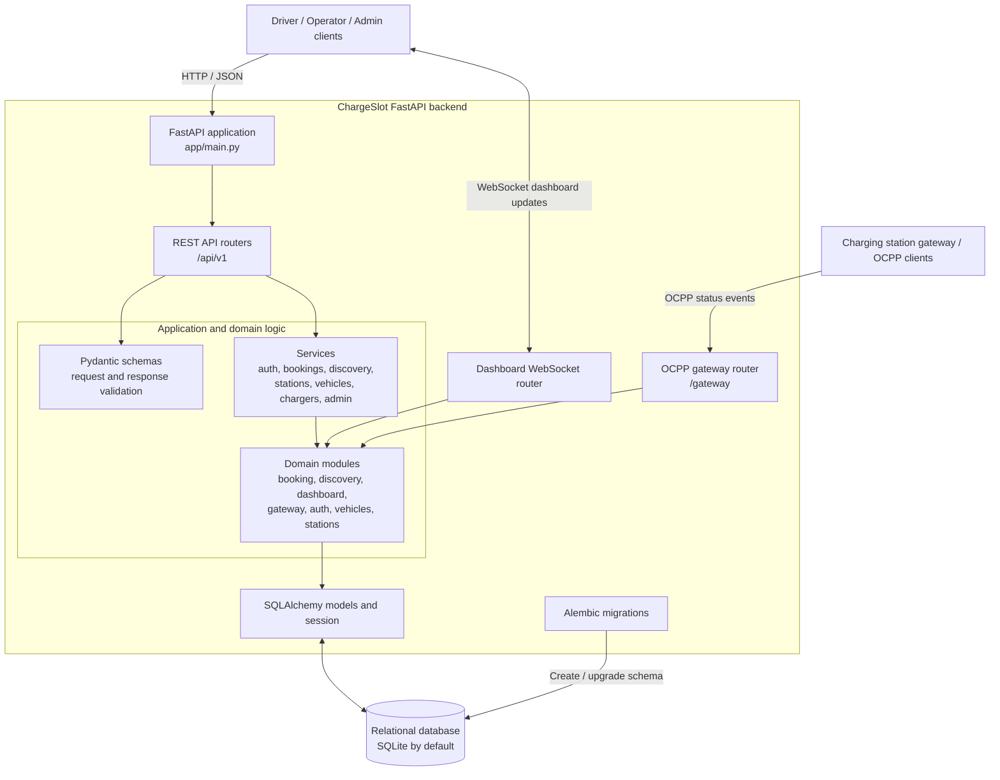

# ChargeSlot Architecture

This diagram reflects the application components present in `chargeslot/backend`. Driver, operator, and administrator clients consume the API; no specific frontend implementation is assumed.

## Request and data flow

1. `app/main.py` creates the FastAPI application and mounts the versioned REST API, dashboard WebSocket router, and gateway routes.
2. REST endpoints validate input and output with Pydantic schemas and call application services for feature behavior.
3. Services and domain modules use the SQLAlchemy session and models to read or persist application data.
4. Gateway events update charger and connector state; dashboard clients can receive real-time updates over the WebSocket endpoint.
5. Alembic manages relational database schema changes. The default local database is SQLite, configurable using `DATABASE_URL`.

The backend exposes the interactive API docs at `/api/v1/docs` and a health check at `/health`.
