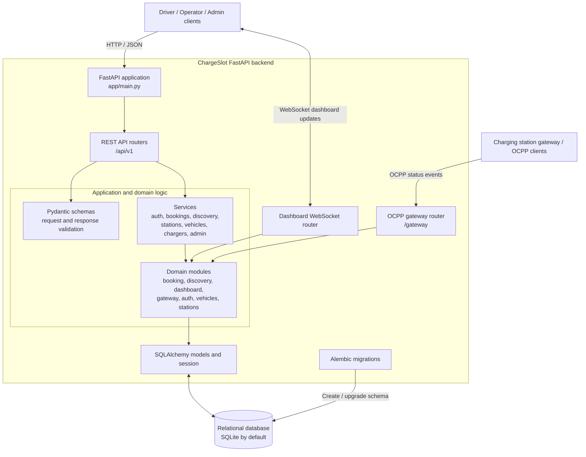
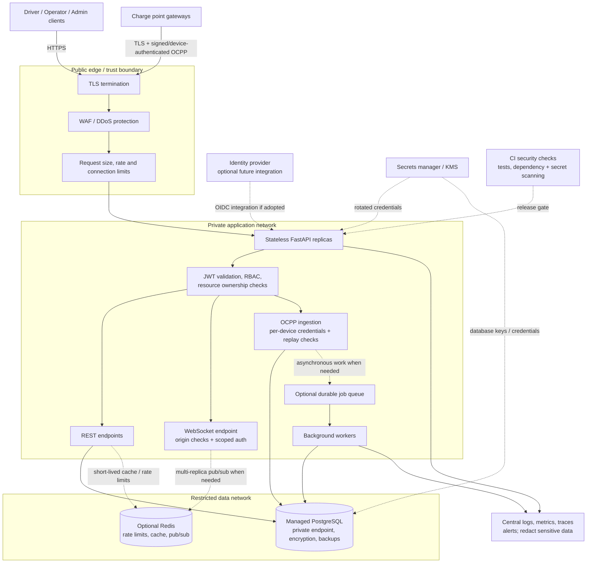

# ChargeSlot Architecture

The first diagram shows the application components present in `chargeslot/backend`. The production target below it adds security and operations controls that are recommendations, not claims about the current implementation. Driver, operator, and administrator clients consume the API; no specific frontend implementation is assumed.

## Request and data flow

1. `app/main.py` creates the FastAPI application and mounts the versioned REST API, dashboard WebSocket router, and gateway routes.
2. REST endpoints validate input and output with Pydantic schemas and call application services for feature behavior.
3. Services and domain modules use the SQLAlchemy session and models to read or persist application data.
4. Gateway events update charger and connector state; dashboard clients can receive real-time updates over the WebSocket endpoint.
5. Alembic manages relational database schema changes. The default local database is SQLite, configurable using `DATABASE_URL`.

The backend exposes the interactive API docs at `/api/v1/docs` and a health check at `/health`.

## Security-aware production target

This is a phased target architecture. The FastAPI application and domain modules are in the repository; the edge controls, managed services, and operational controls shown here must be selected and implemented before production exposure.

### Security controls and rollout notes

- **Network and transport:** expose only the TLS-protected edge; keep the application, database, cache, and queue on private network paths. Restrict outbound access and administrative access.
- **Identity and authorization:** validate short-lived access tokens, enforce role and per-resource ownership checks on every protected operation, and test cross-user and cross-operator access. Keep signing keys outside source control and rotate them through a secrets manager.
- **WebSockets:** validate the browser origin and authorize access to each subscribed station. Prefer a short-lived, single-use connection ticket over putting a reusable bearer token in the URL; URLs commonly appear in access logs.
- **OCPP gateway:** replace the development shared secret with unique, revocable per-device credentials and signed messages with timestamps/nonces, replay protection, rotation, and rate limits. Allowlist network sources only where device networking supports it.
- **Data protection:** use a managed production database with encryption in transit and at rest, least-privilege database credentials, automated encrypted backups, and tested restores. Keep personal data and payment data out of logs; use a payment provider rather than storing card data.
- **Abuse and availability:** apply edge and application rate limits, payload and connection limits, request timeouts, and bounded WebSocket subscriptions. Avoid relying on in-process rate limits or event fan-out when running multiple replicas.
- **Operations:** centralize redacted security and service logs, monitor authentication failures and gateway anomalies, alert on service and database health, and rehearse credential rotation and incident response. Keep API documentation and debug features restricted outside development.
- **Delivery pipeline:** require automated tests for authorization boundaries, dependency and secret scanning, reviewed database migrations, and a release rollback path. Treat a security test failure as a release blocker.

See the [delivery and production-readiness plan](chargeslot-delivery-plan.md) for phase gates, measurable goals, and illustrative cost ranges.

## 17. Security Measures Implemented

| Security Domain / Layer | Architectural Threat / Risk Mitigated | Technical Security Controls Implemented | Traceability / Enforcement |
| :--- | :--- | :--- | :--- |
| **Identity & Authentication** | Credential stuffing, brute-force, dictionary attacks, token theft | • Bcrypt salted hashing (cost factor 12) with zero plaintext persistence. • Password complexity policy (min 8 chars, uppercase, lowercase, digit, symbol). • Account lockout after 5 consecutive failed logins for 15-minute cooldown. • Short-lived HS256 JWT access tokens (30m) with 7-day refresh token rotation. | `REQ-F1-02` `REQ-F1-04` `REQ-F1-05` `HLD §Auth` |
| **Access Control & RBAC** | Privilege escalation, unauthorized vehicle edits, operator data leak | • Strict server-side role dependency injection (`get_current_user`) for Driver, Operator, Admin. • Driver vehicle ownership isolation: non-admin drivers cannot access foreign vehicles. • Multi-tenant operator data scope: station managers strictly isolated to their own stations. • Auto-provisioning of starter EV ensures new drivers book safely without cross-tenant access. | `REQ-F1-10` `REQ-F1-11` `REQ-F1-12` `REQ-F1-26` |
| **Payments & Billing** | Card credential exposure, replay webhooks, duplicate charges | • Zero raw card storage: hosted checkout offloading PAN handling to Razorpay (reduced PCI scope). • Cryptographic HMAC-SHA256 signature verification on incoming payment webhooks. • Idempotent transaction settlement enforcing atomic `PENDING` → `COMPLETED` transitions. • Deterministic PDF tax invoice generation permanently snapshotting tariff and energy readings. | `REQ-F4-01` `REQ-F4-04` `ADR-04` `HLD §Billing` |
| **Slot Booking Concurrency** | Double-booking, slot race conditions, vehicle reservation overlaps | • Database-level transaction locks (`SELECT FOR UPDATE`) on station and slot allocation. • 5-minute temporary slot hold with automatic TTL expiration releasing stale reservations. • Vehicle overlap prevention: blocks concurrent active reservations for the same vehicle. • Automated status sync: expired slot timers restore map marker dot colors back to Available. | `REQ-F3-11` `REQ-F3-12` `REQ-F3-16` `ADR-02` |
| **Geospatial & Input Security** | SQL injection, coordinate tampering, DoS radius scans | • Strict Pydantic v2 input validation with type constraints, bounds checking, and schema sanitization. • SQLAlchemy 2.0 ORM parameterized statements preventing all SQL injection vectors. • Bounded Haversine radius queries (1 to 50 km) preventing unbounded geospatial resource exhaustion. • Path traversal security blocking directory escape attempts (`../`) on static web asset delivery. | `REQ-F2-01` `REQ-F2-04` `HLD §Stations` `FastAPI DI` |
| **Network & Transport** | Man-in-the-Middle (MitM), eavesdropping, packet sniffing | • Enforced HTTPS / TLS encryption on all client-to-server and gateway communications. • Secrets management: zero credentials in Git repository; loaded exclusively from runtime env. • Generic authentication failure messages to prevent user enumeration / username harvesting. • Cross-Origin Resource Sharing (CORS) restricted to authorized client origins. | `REQ-F1-09` `§6 Deployment` `§12 Cross-Cut` |
| **Audit & Compliance** | Non-repudiation failures, unmonitored security events | • Structured immutable audit logging (`AuditService.log_action`) capturing user ID, action, resource, IP. • Security audit events logged for registration, login, lockout, password changes, and slot claims. • Sensitive credential and token redaction from server logs and telemetry streams. • Automated regression test gates (`pytest`, `testclient`) enforcing security invariants in CI pipeline. | `REQ-F1-14` `§12 Cross-Cut` `TC-F1-14` `CI Gates` |

