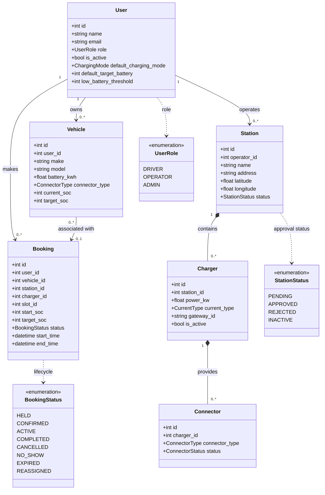

# ChargeSlot UML Class Diagram

The diagram shows the core SQLAlchemy domain entities and relationships implemented by the backend. It is intentionally focused on accounts, vehicles, charging infrastructure, and bookings.

`Booking.station_id`, `charger_id`, and `slot_id` are stored as scalar fields in the current model; they are not declared as SQLAlchemy foreign-key relationships. The vehicle association is optional for a booking.
